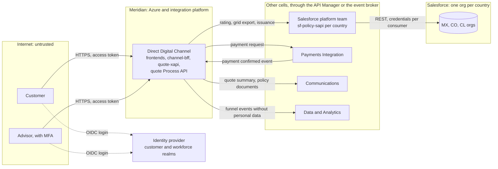
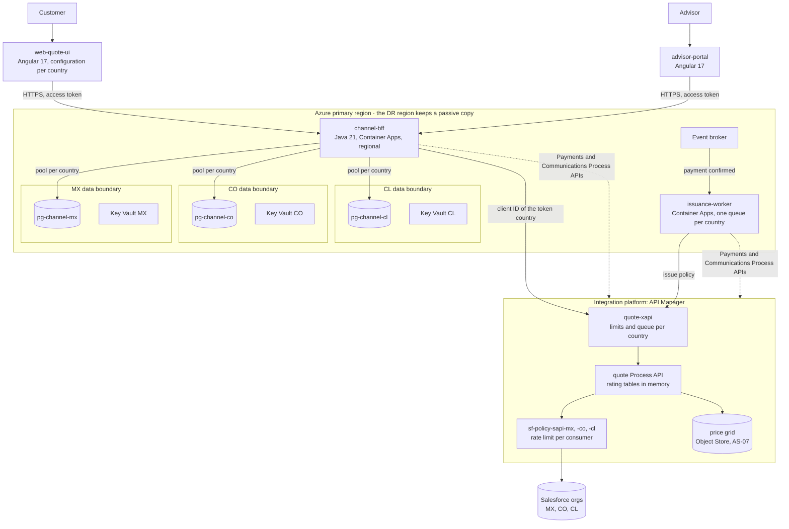
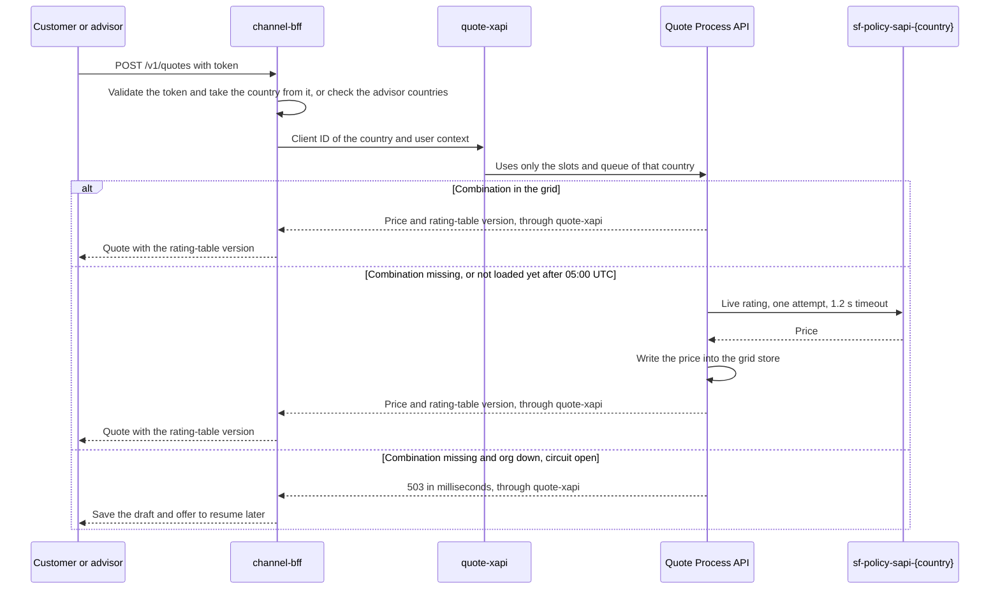

# Target architecture: Direct Digital Channel

Target state of the channel for Home Essentials (BR-01) in MX, CO and CL and, over time, for the current journeys. The decisions are in ADR-0001 (one regional deployment with country configuration and bulkheads) and ADR-0002 (API-led path, price grid, asynchronous issuance). This document does not repeat their options.

## 1. Context (C4 level 1)

## 2. Containers (C4 level 2)

| Trust boundary | What crosses it | Control |
|---|---|---|
| Internet → Azure | HTTPS with an OIDC access token | `channel-bff` validates issuer, audience and signature (`CURRENT_STATE.md:89`) |
| Azure → integration platform | REST | Client ID per country and JWT validation at the API Manager (`CURRENT_STATE.md:78`) |
| Integration platform → Salesforce | REST | OAuth 2.0 client credentials per org (`SALESFORCE_CONSTRAINTS.md:42`); rate limit per consumer below 40 req/s |
| Country data boundary | Personal data | One database and one Key Vault per country, selected with the country of the validated token |

**Cost (C9).** Each shared component has one deployment, sized for the sum of the three month-end peaks. The per-country costs are the databases, the Key Vaults and their DR replicas.

**Issuance.** `issuance-worker` keeps one queue per country, retries with an idempotency key, and sends any case not issued in 24 h to the exception queue (ADR-0002). It issues through `quote-xapi` and the Process API. It runs in Azure because the event broker is there (`SCENARIO.md:29`), the purchase data stays in the country database, and the only MuleSoft developer is the bottleneck (`TEAM.md:19`). With more MuleSoft capacity, it can move to the Process API.

## 3. Regional and country-specific capabilities (C3)

| Capability | Regional, built once | Per country | How the country variation is handled |
|---|---|---|---|
| Quote and purchase screens | `web-quote-ui`, `advisor-portal` | — | Texts, consent versions and currency in configuration; feature flags per country (TD-10) |
| Channel API | `channel-bff`, `quote-xapi` | API Manager client ID | Country from the token in `channel-bff`, and in the path of `quote-xapi` (D-15) |
| Product rules and price | Quote Process API, grid store | Rating in each org; grid content | About 80% common; taxes, mandatory coverages, documents and consent texts in configuration (`SALESFORCE_CONSTRAINTS.md:8`) |
| Access to Salesforce, data and secrets | — | `sf-policy-sapi-{country}` and the org; PostgreSQL database and Key Vault | — |
| Issuance | `issuance-worker` | Queue per country | Documents come from the product configuration of each org |
| CI/CD, observability, identity, API Manager | One platform | SLOs, dashboards and alerts per country | `SLOS.md` |

When configuration cannot express a difference, the country code goes behind an extension point, in its own module with its own tests. Shared code has no country conditionals (`CountryProperties.java:9-10`).

## 4. Reaching Salesforce: C2 and C6 at month-end

Path: `channel-bff` → `quote-xapi` → quote Process API → `sf-policy-sapi-{country}` → org (C4, ADR-0002).

| Hop | p95 budget | Timeout to the next hop |
|---|---|---|
| Browser → `channel-bff` | 150 ms | — |
| `channel-bff` | 50 ms | 4 s to `quote-xapi`, as today (`CURRENT_STATE.md:90`) |
| `quote-xapi` | 100 ms | 3 s to the Process API (today 30 s, A3) |
| Quote Process API, grid lookup included | 100 ms | 1.2 s to the System API, no retry on timeout (ADR-0002) |
| System API and rating in the org | 150 ms + 1,100 ms (`SALESFORCE_CONSTRAINTS.md:16`) | Agreed with the Salesforce platform team, below 1.2 s |
| **Total** | **≈ 1.65 s with live rating; ≈ 0.4 s from the grid** | C2 asks for < 2.5 s |

**C6 at month-end.** The request rate has margin: at the MX peak, 6.6 quotes/s (`channel-metrics.csv 16:20Z MX`, 1,987 ÷ 300 s) × 1.31 calls ≈ 8.7 req/s, 22% of the agreed 40. The daily budget has less: 157,745 × 1.31 ≈ 207,000 calls, 83% of the MX budget (ADR-0002). Home Essentials adds less than 1%, even with live rating (500 × 3 × 1.3 ≈ 2,000 calls), so the risk is in the current MX journeys. Controls: A1, the rate limit per consumer, the alerts of `SLOS.md` §4 and the plan per org (`INTERFACES_AND_GOVERNANCE.md`).

**Price grid.** A persistent key-value store next to the Process API, shared by all replicas. The key is the country, the product, the rating-table version and the answer bands (AS-01); the value is the premium with its taxes. Live prices are written into it, so the same answers do not call Salesforce twice. Only the six rating tables per product stay in memory. The first option is the MuleSoft Object Store; if the MuleSoft deployment or its limits do not fit the grid, it moves to Azure Database for PostgreSQL (AS-07). If the store fails, the Process API uses live rating.

**Org down (≈ 3% of the month).** Home Essentials quotes come from the grid. The current products fail fast, and the customer can save the draft. Payment happens in the session, and issuance waits in the queue of the country (ADR-0002).

## 5. Containing a failure in one country (C1)

| Layer | Control | Source |
|---|---|---|
| API Manager | Client ID and rate limit per country, so we can limit or revoke one country alone | ADR-0001, D-17 |
| `quote-xapi` | In-flight limit and queue per country; a full queue returns 503 with `Retry-After` only to that country; circuit breaker per country and route | A3 |
| Quote Process API | Circuit breaker per country; retry rules of A2; rating tables in memory, so a scale-out costs 6 calls per new replica, not per quote; live rating if the grid store fails | A1, A2 |
| System API | Rate limit per consumer, below 40 req/s | ADR-0002 |
| Data | Database, connection pool and Key Vault per country | ADR-0001 |
| Issuance | Queue per country; an MX backlog does not delay CO or CL | ADR-0002 |
| Release | Progressive traffic shift with metrics per country, automatic rollback, flags per country | `SLOS.md` §5 |
| Proof | Fault-injection gate in UAT: Salesforce slow in one country with month-end load; the other two keep p95 < 2.5 s | ADR-0001 |

**Disaster recovery.** Active-passive: each country database has a read replica in the approved DR region (`SCENARIO.md:25`), with infrastructure code and artifacts ready. RTO 1 h and RPO 5 min are our own targets, because the material gives none; a failover moves the three countries, and we test it twice a year outside month-end. Salesforce outages are covered by ADR-0002, and MuleSoft outages by the DR of the integration platform.

## 6. Identity and data protection (C5)

| Caller | Token | How the country is set | Rules |
|---|---|---|---|
| Customer | Customer realm: `sub`, `ctry`, `sf_account_id` (`CURRENT_STATE.md:94`) | `ctry`; the BFF ignores any country sent by the caller | The customer comes only from the validated token, never from headers or the body (`CustomerContext.java:6-7`) |
| Advisor | Workforce realm with MFA: `sub`, `countries`, `roles` (`CURRENT_STATE.md:95`) | The requested country must be in `countries`, or the answer is 403 | The role must allow quoting; the customer is explicit in the request; the audit log keeps the advisor, the customer and the country |
| `channel-bff` → `quote-xapi` | Client credentials with the client ID of the request country, plus the user context from the validated token (D-17) | `quote-xapi` rejects a path country that does not match the client ID | Token exchange (RFC 8693) is a later step, with the Identity team |

How we meet C5:
- Personal data stays in the database of its country. Secrets live only in Key Vault, read with managed identities (this closes TD-11). Logs use an allowlist of fields and IDs, never personal data.
- People access databases and logs by role and by country.
- Quote drafts are deleted after a retention period per country agreed with Legal (TD-08).
- Every pipeline runs negative tests per country: a CO advisor who asks for MX, or a call to `quote-xapi` with the MX path and the CO client ID, gets 403.
- Regional processing of the three countries needs a documented basis with Legal (AS-06). If Legal rejects it, `channel-bff` and the Process API move to one deployment per country, with the same code (ADR-0001).

## 7. Transition without a big bang

First we close the P1 actions of INC-0907, so we do not build on the same risk. Then Home Essentials is built directly on the target platform, and the current MX journeys change only where they break C4. After the launches, they move one at a time. Dates and capacity are in `ROADMAP.md`.

| When | What moves |
|---|---|
| Dec 2026 – Mar 2027 | INC-0907 P1 actions; grid commitment and MuleSoft loan before 15 Dec; pipeline terms in the Nimbus renewal on 31 Jan (A7b). Process API with Home Essentials (part of TD-01); MX in `channel-bff` and `web-quote-ui` only for Home Essentials (part of TD-03, TD-04); `pg-channel-mx`; TD-05; TD-10. `quote-papi-mx` and the `mx-quote-bff` issuance move to the API-led path (A8, TD-02) |
| Apr – Jun 2027 | Launches by MX 30 Apr, CO 31 May and CL 30 Jun, each behind a country flag and live before the month-end freeze (`ROADMAP.md` §4). If MX does not pass the UAT gates by 15 Mar, we propose to the sponsor that MX launches with CO on 31 May, without going back to the Nimbus stack (D-04) |
| H2 2027 | The current journeys move one at a time. `web-quote-ui-mx`, `mx-quote-bff`, `quote-papi-mx` and `sql-quote-mx` are retired when they have no traffic |

## 8. Guidelines and standards we enforce

For the internal team and Nimbus. Gates and thresholds are in `ENGINEERING_STANDARDS.md`.

| Area | Rule | How we enforce it |
|---|---|---|
| API design | Plural nouns in kebab-case. Experience and Process APIs use `/v{major}/{country}/{resource}`; the BFF takes the country from the token. A breaking change creates a new major version, and the previous one stays at least 6 months with `Deprecation` and `Sunset` headers | OpenAPI lint in the pipeline; consumer-provider contract tests (TD-05) |
| Error model | RFC 9457 problem details with `code` and `correlationId`, as the BFF already does (`channel-quote-api.yaml:60`). No stack traces or personal data in errors | OpenAPI lint; contract tests |
| Country configuration | Versioned configuration per country, with a schema. Country code only behind an extension point. No country conditionals in shared code | Schema validation and tests of the three country configurations in every build; a static rule fails the build on country conditionals |
| Resilience defaults | A timeout on every outbound call, shorter than the caller's; the retry rules of A2; circuit breaker per dependency and country; rating tables cached | Configuration lint (A2); performance gate on Salesforce calls per quote (A1); fault-injection gate (ADR-0001) |
| Identity, secrets and logs | Identity and country only from the validated token. Secrets only in Key Vault. No personal data in logs | Static rule; negative tests per country; secret scanning; log lint |
| Integration | Salesforce and other cells only through the API Manager (C4); an exception needs an approved ADR | The pipeline fails when channel code calls Salesforce hosts or uses a Salesforce client |
| Reuse across countries | A change to shared code runs the tests of the three country configurations and needs a code owner of the cell. Nimbus contributes through pull requests to Meridian repositories and pipelines (A7b) | Branch protection with code owners; one pipeline for everyone |
