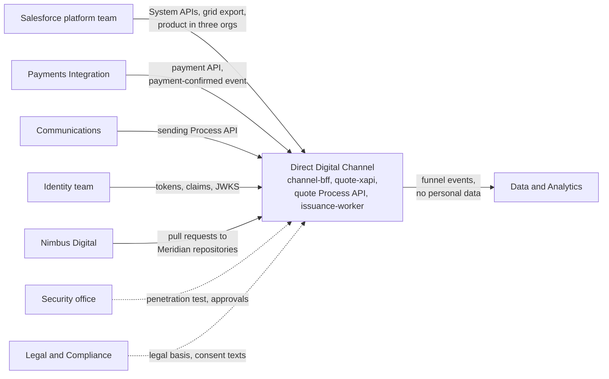

# Interfaces and governance: Direct Digital Channel

What Home Essentials (BR-01) needs from other cells, how we decide with them, and how we plan Salesforce consumption. Dates come from `ROADMAP.md` §4.

## 1. Dependency map

| Provider | What we need | Interface | Agreement | By |
|---|---|---|---|---|
| Salesforce platform team | Home Essentials in each org; grid export (AS-02); credentials per consumer; MuleSoft loan | `sf-policy-sapi-{country}` | Contract in Exchange; rating p95 < 1.2 s (`ARCHITECTURE.md` §4); rate limit per consumer; budget per org (§3); notice of product changes | Grid and loan 15 Dec 2026; MX org 15 Feb, CO and CL 15 Apr 2027 |
| Payments Integration | Payment start; `payment-confirmed` event | Process API; event broker (`SCENARIO.md:29`) | AsyncAPI schema with an idempotency key; delivery p95 < 30 s; protocol of §3 | MX 1 Mar; CO and CL 15 Apr 2027 |
| Communications | Quote summary; policy documents | Process API (`CURRENT_STATE.md:109`) | Templates per country; sending p95 < 60 s | MX 1 Mar; CO and CL 15 Apr 2027 |
| Identity team | Tokens with `ctry`, `sf_account_id`, `countries`, `roles`; one `channel-bff` client per country | OIDC, JWKS | Claims contract; JWKS overlap before key rotation; no rotation at month-end | 15 Mar 2027 |
| Data and Analytics | Consumes funnel events | Event broker | Schema without personal data; reports from a read replica | MX launch |
| Nimbus Digital | MX legacy work; Home Essentials from February | Pull requests to Meridian repositories | Renewal terms (`ENGINEERING_STANDARDS.md` §4) | 31 Jan 2027 |

Approvals: the Security office runs the penetration test before 15 Mar 2027 and decides AS-17 and the `web-quote-ui-mx` exception; Legal approves the basis for regional processing by 31 Jan 2027 (AS-06) and the consent texts before each launch.

Every interface has a contract in its catalog (OpenAPI in Exchange, AsyncAPI for events), consumer contract tests (`ENGINEERING_STANDARDS.md` §1), an SLO and an owner. The Payments and Communications targets keep issuance inside the 3 minutes of BR-01: 30 s + 4 s of issuance p95 (`SALESFORCE_CONSTRAINTS.md:18`) + 60 s ≈ 1.6 min, with room for the queue and one retry. A missed date goes to the architecture forum, then to the sponsor.

## 2. Decisions that affect several cells

Today the forum records decisions in meeting notes (`TEAM.md:24`). We propose:

| Step | Rule |
|---|---|
| Scope | A change to a shared interface, SLO or resource (org allocation, API Manager, event broker), or to another cell's work |
| Record | An ADR (`ADR-0000` template) in a shared architecture repository; the forum notes link to it |
| Review | Circulated one week before the forum; the affected Technical Leads comment on the pull request |
| Decide | Consent: accepted if no affected Technical Lead raises a blocking objection, with a reason and an alternative |
| Escalate | No agreement after two forums: the Architecture office and the directors of the affected cells decide |
| Emergency | The incident commander decides; the ADR follows within 5 working days |

First cases: ADR-0001 and ADR-0002, the protocol of §3 and the version catalog of §4.

## 3. Salesforce API consumption per org

**Model.** Calls per day = transactions × calls per transaction × peak factor, per journey and org, plus requests per second in the peak 5 minutes.

| Org | Channel, normal day (24–29 Sep average) | Channel, month-end with the cache | Channel budget | Org peak: normal / month-end |
|---|---|---|---|---|
| MX | 140,300 (56%) | ≈ 207,000 (83%): 157,745 quotes × 1.31 | 250,000 | 46–49% / ≈ 50% |
| CO | 152,200 (51%) | 183,197 (61%) | 300,000 | 40–42% / 43% |
| CL | 67,900 (45%) | 79,395 (53%) | 150,000 | 36–38% / 40% |

Source: `sf-api-usage-daily.csv`. MX org at month-end ≈ (0.888 × 2,000,000 − 984,078 + 207,000) ÷ 2,000,000 ≈ 50%: the other consumers used ≈ 792,000 calls on 30 Sep. Home Essentials adds less than 2,000 calls per org per day (`ARCHITECTURE.md` §4). The risk is the MX channel budget at month-end (17% margin), not the org.

| Step | How |
|---|---|
| Plan | Each quarter, every consumer declares its calls per day and per second, normal and month-end, and its priority tier. Org peak below 75%. Approved as an ADR (§2) |
| Agree | The Salesforce platform team enforces each line with a rate limit per consumer at the System API |
| Measure | Calls per quote in the performance gate, at most baseline + 20% (A1); alerts per consumer and org (A4, `SLOS.md` §4); weekly review during the launches, then monthly |
| Correct | A consumer above its line for two weeks brings a fix or a new line to the forum |

**Protocol at 75% of the org (A10).** Payments must never reach its pause at 85% (`SALESFORCE_CONSTRAINTS.md:37`).

| Tier | Traffic | Action at 75% |
|---|---|---|
| 1 | Work that can wait, as each consumer declares it: reporting jobs, the channel issuance queue | Pauses until the org is below 70% |
| 2 | Synchronous channel quotes | Rate limit down to the planned peak (MX ≈ 9 req/s, `ARCHITECTURE.md` §4); the excess fails fast and saves the draft; Home Essentials keeps quoting from the grid |
| 3 | Payments | Continues |

The channel applies tiers 1 and 2 to its own traffic from day one, even before the other consumers agree. Paused issuance delays policies already paid; the exception queue covers them after 24 h (ADR-0002). We test the protocol in a tabletop exercise with Payments and the Salesforce platform team.

## 4. Version catalog

Exchange lists each API version with its owner, consumers (the client IDs seen by the API Manager), status and dates. The forum reviews it every quarter. A version is retired only when the API Manager shows no traffic from its consumers, or their Technical Leads agree.

| API and version | Consumers | Status | Deprecation | Sunset |
|---|---|---|---|---|
| `quote-xapi` v3 (`quote-experience-api.yaml`) | `channel-bff` for Home Essentials | In UAT for the MX gate, 15 Mar 2027 | — | — |
| `quote-xapi` v2 | `channel-bff` for the current CO and CL journeys; `mx-quote-bff` (`CURRENT_STATE.md:46-47`) | Active | When the last current journey uses v3, planned for 31 Dec 2027 (`ARCHITECTURE.md` §7) | 6 months later, planned for 30 Jun 2028 |
| `channel-bff` `/v1/quotes` | `web-quote-ui`, `advisor-portal` | Active; Home Essentials uses it with `product` | — | — |
| `payment-confirmed` event v1 | `issuance-worker` | To agree with Payments | — | — |
