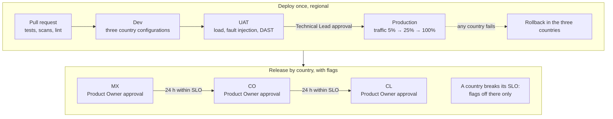

# Engineering standards: Direct Digital Channel

For the internal team and Nimbus Digital. The architecture rules are in `ARCHITECTURE.md` §8; this document covers how we test, gate, review and deliver. Baseline: `DELIVERY_METRICS.md`. Pipeline: `pipeline-template.yml`.

## 1. Test strategy

Developers write and maintain the automated tests of their own code, Nimbus included. The only QA engineer (`TEAM.md:10`) owns the end-to-end and performance suites and spends the rest of the time on exploratory tests per country in UAT.

| Level | Tests | Written by | Runs |
|---|---|---|---|
| Frontends (`web-quote-ui`, `advisor-portal`) | Unit and component; each country configuration; accessibility; end-to-end smoke of quote and buy per country | Front-end developers; QA (end-to-end) | Every PR; end-to-end after each deploy to dev and UAT |
| `channel-bff`, `issuance-worker` | Unit; integration with Testcontainers and a `quote-xapi` stub; startup and security per country (`ARCHITECTURE.md` §6); one policy per payment event | Back-end developers | Every PR |
| `quote-xapi`, quote Process API | MUnit; each country configuration | Integration developer; Nimbus for its components | Every PR |
| Contracts (C3, TD-05) | Pact between the frontends, `channel-bff` and `quote-xapi`. MuleSoft is verified over HTTP, or against the provider's OpenAPI in Anypoint Exchange when it is the consumer | The consumer writes; the provider verifies | Every PR; `can-i-deploy` before each environment |
| Performance (C2) | Month-end profile (3× MX, 2× CO and CL) against simulated System APIs (AS-18) | QA engineer with the developers | UAT, before every production deploy |
| Resilience (C1) | Salesforce slow, then down, in one country under month-end load; the other two keep p95 < 2.5 s (A2, A3) | QA engineer, Technical Lead | UAT, on changes to timeouts, retries or concurrency (ADR-0001), and every night |

Security scans are gates (§2). The Security office runs a penetration test before each country launch.

## 2. Delivery flow and quality gates

We deploy once for the three countries and release each country with flags (TD-10). The Product Owner sets the release order; Home Essentials goes MX, CO, CL (`ROADMAP.md` §4).

| Gate | Threshold | Stage | On failure |
|---|---|---|---|
| Build and tests | 100% pass; the service starts with the MX, CO and CL configurations (`REVIEW.md` #7) | PR | Merge blocked |
| Coverage | ≥ 80% of new and changed lines; the total does not go down (TD-09) | PR | Merge blocked |
| Mutation score | ≥ 60% on changed Java and TypeScript code | PR | Report only in Q1 2027; blocks from Q2 |
| Static analysis | 0 new blocker or critical issues; the rules of `ARCHITECTURE.md` §8 and A2 | PR | Merge blocked |
| Security scans | SAST: 0 new critical or high. Secrets: 0, also in a pre-commit hook. SCA, container and IaC: 0 critical; high fixed in 30 days. Licenses outside the allow-list: 0 (`AI_GUIDELINES.md` §4) | PR, build, nightly | Blocked. An exception needs the Security office and an end date; an exposed secret is rotated (TD-06, TD-11) |
| API contract | 0 lint errors; no breaking change inside a major version (`REVIEW.md` #6); `can-i-deploy` passes | PR, each deploy | Blocked |
| Performance | p95 < 2.5 s per country, errors < 0.5%, Salesforce calls per quote ≤ baseline + 20% (A1) | UAT | Production blocked; more calls need a new budget with the org (`INTERFACES_AND_GOVERNANCE.md`) |
| Resilience and DAST | Fault injection passed for this change or in the last 7 nights; DAST 0 high | UAT | Production blocked |
| Production checks | Approval of the Technical Lead or a delegated code owner; no freeze (last two days of the month, A6); budget of the target countries not exhausted (`SLOS.md` §3) | Production, release | Waits; emergency fixes need the incident commander. A shared deploy continues with the new features off in the country without budget (ADR-0001) |
| Progressive traffic shift | At each step, per country: under the fast-burn threshold, p95 < 2.5 s, calls per quote ≤ baseline + 20% (`SLOS.md` §5) | Production | Rollback in the three countries |
| Release by country | Product Owner approval; the country keeps its SLOs for 24 h before the next one | Release | Flags off in that country only |

## 3. Code review and branching

| Topic | Rule |
|---|---|
| Branching | Trunk-based: protected `main`, branches of at most 2 days, PR with squash merge. A release is a tagged build of `main`. Unfinished work stays behind a country flag; hotfixes use the same pipeline |
| Approvals | One approval from someone other than the author; two, one from a code owner, for API contracts, identity, personal data, Salesforce calls and shared country configuration. A Meridian reviewer approves every Nimbus PR, which today reviews itself (`DELIVERY_METRICS.md`). First review within one business day |
| PR template | Evidence, not checkboxes: test and scan results, configuration changes, Salesforce calls per quote, personal data and AI assistance (`REVIEW.md` #15) |
| AI-assisted changes | Declared in the PR and reviewed like any change: the author answers for every line. Reviewers check that generated tests can fail (`REVIEW.md` §4); generated security code needs the second approval. Details in `docs/ai/AI_GUIDELINES.md` |
| Definition of done | One for everyone, none today (`DELIVERY_METRICS.md`): gates green, contract published, alerts and runbook updated |

## 4. Nimbus Digital (C8)

Terms of the renewal of 31 Jan 2027, verified with Meridian data, not with vendor reports.

| Requirement | How we verify it |
|---|---|
| Home Essentials work from February, and the MX legacy components by 1 Apr 2027, only in Meridian repositories and pipelines; the shared credential is revoked (TD-06, A7b; A7a until then) | 100% of MX production deploys in pipeline logs |
| The same definition of done, gates and thresholds, with no bypass | Required-template check; monthly report from pipeline data |
| On-call: 15-minute response for SEV1 and SEV2; it joins postmortems and owns its actions | Incident records |
| Critical vulnerabilities fixed in 7 days, high in 30; data stays in the Meridian tenant; AI tools only under `AI_GUIDELINES.md`; Meridian owns the code | SCA dashboard; Security office audit |
| Service credits tied to the change failure rate and the SLOs of its components; right to audit; exit plan | Quarterly business review |

## 5. Delivery targets for the end of Q2 2027

Regional: the shared components of `ARCHITECTURE.md` §3. MX legacy: `web-quote-ui-mx`, `mx-quote-bff` and `quote-papi-mx`, until their retirement in H2 2027.

| DORA metric | Baseline CO · CL · MX | Regional | MX legacy | Reasoning |
|---|---|---|---|---|
| Deployment frequency | Weekly · biweekly · monthly | ≥ 2 per week per component | Biweekly | Small changes with trunk-based development, flags and one pipeline. MX legacy gets only fixes, A8 and TD-02 |
| Lead time (median) | 6 · 11 · 24 days | ≤ 3 days | ≤ 10 days | Automated gates replace the manual waits in UAT |
| Change failure rate | 12% · 18% · 31% | ≤ 10% | ≤ 15% | Contract tests (TD-05), the performance gate and the traffic shift. The INC-0907 change went out the night before: the calls-per-quote rule would have rolled it back at low traffic |
| Time to restore (median) | 3 h · 5 h · 9 h | ≤ 1 h | ≤ 2 h | SLO alerts instead of contact center reports (TD-07), automatic rollback and flags. INC-0907 lasted 1 h 55 min |

Elite values are not realistic in two quarters next to BR-01. We measure per component from pipeline data every month; the error budgets of `SLOS.md` decide when to slow down. The MX targets are recalibrated after two months (AS-19).

## 6. Golden path for a new service or API

Two template repositories: `bff-service-template` (Java 21, Spring Boot 3, Container Apps) and `mule-api-template`. A service is on the golden path when the template's conformance checks pass in its pipeline.

| Area | What the template includes |
|---|---|
| Pipeline and repository | `azure-pipelines.yml` extending `pipeline-template.yml` (production accepts only that template); CODEOWNERS; branch policies; the PR template; ADR and runbook templates |
| Code defaults | The rules of `ARCHITECTURE.md` §8 in place: OpenAPI skeleton with lint, error handler, identity from the token, country configuration schema, outbound client with timeouts, circuit breaker, bulkhead and A2 retries, Key Vault, log allowlist |
| Operations | OpenTelemetry with a `country` dimension; health probes; flags per country; SLO dashboard and alerts as code |
| Tests and infrastructure | Unit, startup per country, Pact, load and fault-injection skeletons; Bicep for the app and the per-country database and Key Vault |
