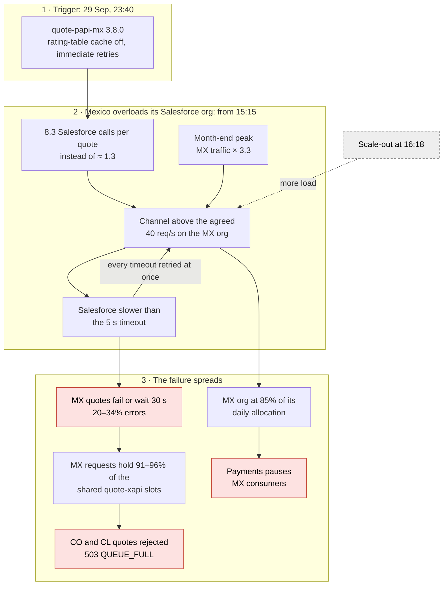

# INC-0907 Postmortem: quote journey degraded in MX, CO and CL

**Summary.** On 30 Sep 2026, the last day of the month, the quote journey failed or slowed down in the three countries from 15:25 to 17:20 UTC (1 h 55 min), and MX payment notifications were delayed from 16:55 to 18:20 (`INC-0907.md:5,18`). `quote-papi-mx` 3.8.0, deployed the night before, made each MX quote cost ≈ 8 Salesforce calls instead of ≈ 1.3 and retried timeouts immediately. At the MX month-end peak Salesforce slowed down, and slow MX requests filled the `quote-xapi` pool that the three countries share. Rolling back to 3.7.2 mitigated it.

## 1. Triage as it should have been done

| Item | What should have happened |
|---|---|
| Severity | **SEV2 at 15:46**: errors on the core journey in three countries, "major feature degraded for many users" (`INC-0907.md:13`; chat 15:46). **SEV1 if payments stop** (16:55 in the event). It was declared SEV3 (chat 15:52). With the involvement below, the SEV1 was avoidable |
| Impact at 15:45 | 5xx at `quote-xapi`: MX 22.6% (p95 30 s, the cap) · CO 8.3% (p95 15.2 s) · CL 8.3% (p95 16.4 s) (`channel-metrics.csv 15:45Z`). The BFF gives up at 4 s (`CURRENT_STATE.md:90`), so customers saw more failures than this |
| Total impact | Failed at `quote-xapi`: MX ≈ 9,400 · CO ≈ 1,500 · CL ≈ 700. Contact center calls: 1,140 · 860 · 310. Customers who gave up are not counted (`INC-0907.md:22-28`) |
| Involve from 15:46 | Incident commander, channel on-call, integration engineer (`quote-xapi`), Nimbus on-call (`quote-papi-mx` held 61–62 of 64 slots per replica and was the latest change: `quote-xapi.log:12-13`, `TIMELINE.md:8`), contact center leads, Director of Digital Channels, Identity team (to postpone the 16:00 rotation) |
| Involve by 16:15 at the latest | Salesforce platform team and Payments Technical Lead: the MX org was at 75.6% and rising ≈ 1.1 points per 5 min, ≈ 40 min from the 85% payments pause (`shared-metrics.csv 15:45Z–16:15Z`; `SALESFORCE_CONSTRAINTS.md:37`) |

**First communication (≈ 15:55):** "SEV2. The quote journey is degraded in MX, CO and CL since about 15:25 UTC: errors or waits over 4 s, worst in Mexico. Current lead: `quote-xapi` saturated by slow `quote-papi-mx` responses (3.8.0, deployed 29 Sep 23:40). Non-essential changes are on hold, including the 16:00 key rotation. Incident commander: Technical Lead, Direct Digital Channel. Next update at 16:15 UTC."

## 2. Timeline (UTC)

| Time | Event | Evidence |
|---|---|---|
| 09-29 23:40 | 3.8.0 deployed from Nimbus CI: cache off, 4 attempts, no backoff | `TIMELINE.md:8`; `quote-papi-mx.log:2` |
| 14:00 | Before any impact: 8.3 Salesforce calls per MX quote (≈ 1.3 normally) and the MX org at 59.0% (normal peak 45.8–48.6%). No alert | `channel-metrics.csv 14:00Z` (5,021 ÷ 605); `shared-metrics.csv 14:00Z`; `sf-api-usage-daily.csv` |
| 15:15–15:27 | Channel passes 40 req/s on the MX org; Salesforce p95 passes the 5 s timeout; retries; first MX `504` | `channel-metrics.csv 15:15Z–15:30Z`; `quote-xapi.log:6` |
| 15:34–15:46 | `quote-xapi` in-flight limit reached; first `503 QUEUE_FULL` for CL and CO; MX holds 61–62 of 64 slots per replica; on-call sees errors in the three countries | `quote-xapi.log:7,10-13`; chat 15:41, 15:46 |
| 15:52 | Declared SEV3; CO assumed to be the most affected | chat 15:52 |
| 16:00–16:21 | Key rotation 401s and database hypothesis, both ruled out; vendor: "should help, not hurt"; `quote-xapi` scaled from 2 to 4 replicas | `quote-xapi.log:16-23`; chat 16:02–16:18 |
| 16:55–16:58 | MX org at 85%: Payments pauses MX consumers. Salesforce platform team: channel user at ≈ 856k calls since 00:00 (budget 250k), mostly `Rating_Table__c` | chat 16:55, 16:58 |
| 17:00–18:20 | Rollback to 3.7.2, mitigated at 17:20; temporary +500k calls; payments resume and the incident closes at 18:20 | chat 17:00–18:20; `quote-papi-mx.log:24-27` |

## 3. Root cause and contributing factors

**Root cause.** 3.8.0 removed the rating-table cache and retried timeouts immediately (`quote-papi-mx.log:2`). Calls per MX quote went from ≈ 1.3 to 8.3, and to 15.0 with retries (`channel-metrics.csv 16:30Z`: 28,577 ÷ 1,906). At the 3.3× peak the channel sent 44–96 req/s to the MX org against the agreed 40 (`SALESFORCE_CONSTRAINTS.md:19`). Traffic alone was not the cause: at 17:20, on 3.7.2, MX handled 92% of peak traffic at p95 831 ms (`channel-metrics.csv 17:20Z`: 1,831 ÷ 1,987).

**How it unfolded.**

| # | Contributing factor | Evidence |
|---|---|---|
| CF1 | One in-flight pool and one queue in `quote-xapi` for the three countries; MX held 91–96% of the slots | `CURRENT_STATE.md:74-75`; `shared-metrics.csv` |
| CF2 | 30 s timeout and no circuit breaker in `quote-xapi`, while the BFF gives up at 4 s. MX needed ≈ 190–198 slots against 128 (Little's law: req/s × 30 s) | `CURRENT_STATE.md:76,90`; `channel-metrics.csv 15:35Z` (1,901 ÷ 300 × 30) |
| CF3 | Retries on timeout with no backoff, jitter or retry budget | `quote-papi-mx.log:2,10-22` |
| CF4 | Cache removed for "fresh prices", although tables up to 24 h old are accepted; the notes said "No configuration changes required" | `TIMELINE.md:17,20`; `SALESFORCE_CONSTRAINTS.md:25` |
| CF5 | `quote-papi-mx` calls the MX org directly, bypassing the System API and the API Manager (C4, C6) | `CURRENT_STATE.md:66-67` |
| CF6 | No consumption or SLO alerts: the overrun was visible from the morning | `SALESFORCE_CONSTRAINTS.md:38`; `shared-metrics.csv 14:00Z` |
| CF7 | Nimbus deploys from its own CI with no Meridian gates and no performance tests | `CURRENT_STATE.md:101`; `DELIVERY_METRICS.md:13` |
| CF8 | Planned key rotation on the riskiest day of the month | `TIMELINE.md:10` |
| CF9 | Response: low severity, anchoring on CO, scale-out without a hypothesis, Payments told only at 85% | chat 15:52, 16:18, 16:55 |

**Ruled out:**
- `pg-channel-co` and the funnel report: CO failed at `quote-xapi` (`QUEUE_FULL`) before reaching the database, BFF queries took 37–44 ms, and errors outlived the report (`quote-xapi.log:11`; `pg-channel-co.log:5-8`; chat 16:11).
- Key rotation: 401s only from 16:00 to 16:05, 35 min after the impact began (`quote-xapi.log:16-20`).
- `channel-bff` 5.2.0: deployed 44 h earlier; the CO and CL Process APIs stayed at p95 616–689 ms (`TIMELINE.md:7`; `channel-metrics.csv`).
- Compute shortage in `quote-xapi`: CPU at 38%; the in-flight cap was the limit (chat 15:46).
- Salesforce outage: the CO and CL orgs stayed normal, and MX latency tracked the channel's own request rate (`channel-metrics.csv`).

## 4. Five whys and response analysis

**MX.** (1) `quote-papi-mx` took 32–52 s per quote at p95. (2) Salesforce calls timed out at 5 s and were retried at once. (3) Salesforce slowed under up to 96 req/s against 40. (4) 3.8.0 made each quote ≈ 8–15 calls, at triple traffic. (5) The change shipped with no performance test, no consumption check and an unreconciled pricing request (CF4, CF7).

**CO and CL, with healthy back ends.** (1) `quote-xapi` queued or rejected them. (2) MX held 91–96% of the slots. (3) Each MX request held a slot for up to 30 s. (4) One pool for all countries and no circuit breaker. (5) `quote-xapi` became regional in 2026-Q2 for reuse (C3) with no isolation requirement (C1) (`CURRENT_STATE.md:65`).

**Almost two hours.** (1) The cause was found at 16:58, 1 h 06 min after the declaration. (2) The team chased the first reporting country and two coincidences, and scaled out. (3) No alert pointed at the cause, and SEV3 did not bring in the vendor, the Salesforce platform team or Payments. (4) There was no "what changed in 72 h?" step. (5) There is no shared incident playbook.

| Helped | Made it worse |
|---|---|
| Fast report from the CO contact center (15:41); the DBA ruled out the database with evidence in 7 min | SEV3 and CO assumed to be the origin; the vendor's "should help" accepted without data |
| The Identity team reported the rotation's effect openly (16:06) | The rotation went ahead during the incident |
| The Salesforce platform team's per-integration consumption (16:58): the decisive clue | The scale-out raised Salesforce load from 75 to 96 req/s and the org from 75.6% to 85.8%, which triggered the payments pause |
| Rollback in 5 min, with a warm cache | The per-route log (15:44) went unused; there are no per-country dashboards |

## 5. Action items

**P1** before the next month-end peak · **P2** within the quarter · **P3** roadmap.

| # | Action | Owner | Priority | How we verify it works |
|---|---|---|---|---|
| A1 | Rating-table cache mandatory in every quote Process API, refreshed after 05:00 UTC; quotes record the table version | Nimbus (`quote-papi-mx`); Technical Lead (standard) | P1 | Calls per quote ≤ 1.5 per org; a performance gate fails above baseline + 20% |
| A2 | Retry standard: no retry on timeout; at most 1 retry on fast failures, with backoff and jitter; retry budget ≤ 10%; deadline below the caller's timeout | Technical Lead; all teams | P1 | Configuration lint in the pipeline; fault injection (Salesforce at 6 s) keeps calls per quote ≤ 2 |
| A3 | Per-country bulkheads in `quote-xapi`, a circuit breaker per route, and an outbound timeout aligned to the BFF's 4 s | Integration engineer | P1 | 30 s latency injected on MX: CO and CL p95 < 2.5 s and zero `QUEUE_FULL` |
| A4 | Salesforce consumption alerts per integration user and org: > 32 req/s for 5 min; 24-h budget at 50/75/90%; org ≥ 75% notifies the channel and Payments | Salesforce platform team; Technical Lead | P1 | 30 Sep replay: budget alert hours before the impact, rate alert by 15:15, org alert at 16:15 |
| A5 | SLO alerting per country and journey, measured at `channel-bff` with timeouts included (`SLOS.md`) | Technical Lead | P1 | 30 Sep replay pages for MX by 15:50 |
| A6 | Change freeze on the last two days of each month, shared dependencies and key rotations included | Technical Lead; change management; Identity team | P1 | Pipelines block production deploys in the window |
| A7a | Interim: every Nimbus release to production in MX needs Technical Lead approval and declares configuration changes and calls per quote | Technical Lead; Nimbus | P1 | No release without a recorded approval |
| A7b | Nimbus deploys through Meridian pipelines with the same gates, and its deployment credential is revoked; both become terms of the 31 Jan 2027 renewal (C8) | Technical Lead; vendor management | P2 | 100% of MX deploys come from Meridian pipelines |
| A8 | `quote-papi-mx` reaches Salesforce through `sf-policy-sapi-mx`, with per-consumer rate limiting (C4) | Nimbus; Salesforce platform team | P2 | Zero direct calls from the channel to the MX org |
| A9 | Incident playbook: severity examples (multi-country quote degradation is at least SEV2; payments stopped is SEV1), incident commander rotation, and a first-15-minutes checklist (recent changes, per-route saturation, shared-dependency usage) | Director of Digital Channels; Technical Lead | P2 | Game day: declared within 15 min at the right severity |
| A10 | Protocol with Payments and the Salesforce platform team: at org ≥ 75% the channel throttles first, before Payments pauses | Technical Lead; Payments TL; Salesforce platform team | P2 | Tabletop exercise; protocol recorded in `INTERFACES_AND_GOVERNANCE.md` |
| A11 | Reconcile "fresh prices" with the 24-h rule; any caching change needs Product Owner sign-off | Product Owner; MX pricing team | P1 | Decision recorded and linked from A1 |
| — | **Latent risks** (not causal): move the funnel report off the primary database; publish IdP keys before use | Data & Analytics (report); Identity team (keys) | P3 | No reports on the primary; next rotation with zero 401s |
