# INC-0907 Postmortem: quote journey degraded in MX, CO and CL

**Summary.** On 30 Sep 2026, the last day of the month, the quote journey failed or was slow in the three countries from 15:25 to 17:20 UTC (1 h 55 min). MX payment notifications were also delayed from 16:55 to 18:20 (`INC-0907.md:5,18`). The cause was `quote-papi-mx` 3.8.0, deployed the night before. With this version, each MX quote made ≈ 8 Salesforce calls instead of ≈ 1.3, and timeouts were retried immediately. With the MX month-end peak, Salesforce became slow, and the slow MX requests filled the `quote-xapi` pool that the three countries share. The rollback to 3.7.2 mitigated the incident.

## 1. Triage as it should have been done

| Item | What should have happened |
|---|---|
| Severity | **SEV2 at 15:46**, because the main journey had errors in three countries, which matches "major feature degraded for many users" (`INC-0907.md:13`; chat 15:46). **SEV1 if payments stop**, which happened at 16:55. The team declared SEV3 (chat 15:52). If the people below had joined in time, the SEV1 could have been avoided |
| Impact at 15:45 | 5xx at `quote-xapi`: MX 22.6% (p95 30 s, the maximum) · CO 8.3% (p95 15.2 s) · CL 8.3% (p95 16.4 s) (`channel-metrics.csv 15:45Z`). The BFF stops waiting at 4 s (`CURRENT_STATE.md:90`), so customers saw more failures than these |
| Total impact | Failed requests at `quote-xapi`: MX ≈ 9,400 · CO ≈ 1,500 · CL ≈ 700. Calls to the contact center: 1,140 · 860 · 310. These numbers do not include customers who left without receiving an error (`INC-0907.md:22-28`) |
| Involve from 15:46 | Incident commander, channel on-call, integration engineer (`quote-xapi`), Nimbus on-call (`quote-papi-mx` held 61–62 of the 64 slots per replica and was the most recent change, `quote-xapi.log:12-13`, `TIMELINE.md:8`), contact center leads, Director of Digital Channels, and the Identity team to postpone the 16:00 rotation |
| Involve by 16:15 at the latest | Salesforce platform team and Payments Technical Lead, because the MX org was at 75.6% and growing ≈ 1.1 points every 5 min, ≈ 40 min before the 85% level where Payments pauses (`shared-metrics.csv 15:45Z–16:15Z`; `SALESFORCE_CONSTRAINTS.md:37`) |

**First communication (≈ 15:55):** "SEV2. The quote journey is degraded in MX, CO and CL since about 15:25 UTC: errors or waits over 4 s, worst in Mexico. Main hypothesis: `quote-xapi` saturated by slow `quote-papi-mx` responses (3.8.0, deployed 29 Sep 23:40). Non-essential changes are on hold, including the 16:00 key rotation. Incident commander: Technical Lead, Direct Digital Channel. Next update at 16:15 UTC."

## 2. Timeline (UTC)

```mermaid
gantt
    title INC-0907 on 30 Sep 2026 (UTC)
    dateFormat HH:mm
    axisFormat %H:%M
    todayMarker off
    section Salesforce
    MX org usage 59% to 85%           : 14:00, 16:55
    Channel above 40 req/s on MX org  : crit, 15:15, 17:10
    section Customer impact
    MX quotes fail or slow            : crit, 15:25, 17:20
    CO and CL rejected by quote-xapi  : crit, 15:35, 17:10
    MX payments paused                : crit, 16:55, 18:20
    section Response
    Detected by CO contact center     : milestone, 15:41, 1m
    SEV3 declared                     : milestone, 15:52, 1m
    Hypotheses ruled out (key rotation, DB) : 16:00, 16:11
    Scale-out 2 to 4 replicas         : milestone, 16:18, 1m
    Cause identified                  : milestone, 16:58, 1m
    Rollback to 3.7.2                 : 17:00, 17:05
    Mitigated                         : milestone, 17:20, 1m
```

| Time | Event | Evidence |
|---|---|---|
| 09-29 23:40 | Nimbus deploys 3.8.0 from its own CI, with the cache off, 4 attempts and no backoff | `TIMELINE.md:8`; `quote-papi-mx.log:2` |
| 14:00 | Before any impact, each MX quote already makes 8.3 Salesforce calls (≈ 1.3 on a normal day) and the MX org is at 59.0% (normal peak 45.8–48.6%). No alert fires | `channel-metrics.csv 14:00Z` (5,021 ÷ 605); `shared-metrics.csv 14:00Z`; `sf-api-usage-daily.csv` |
| 15:15–15:27 | The channel goes above 40 req/s on the MX org, the Salesforce p95 goes above the 5 s timeout, retries start, and the first MX `504` appears | `channel-metrics.csv 15:15Z–15:30Z`; `quote-xapi.log:6` |
| 15:34–15:46 | `quote-xapi` reaches its in-flight limit and rejects the first CL and CO requests with `503 QUEUE_FULL`. MX holds 61–62 of the 64 slots per replica. The on-call sees errors in the three countries | `quote-xapi.log:7,10-13`; chat 15:41, 15:46 |
| 15:52 | SEV3 is declared, assuming that CO is the most affected country | chat 15:52 |
| 16:00–16:21 | The team rules out the key rotation 401s and the database. The vendor says the change "should help, not hurt". `quote-xapi` is scaled from 2 to 4 replicas | `quote-xapi.log:16-23`; chat 16:02–16:18 |
| 16:55–16:58 | The MX org reaches 85% and Payments pauses its MX consumers. The Salesforce platform team reports ≈ 856k calls from the channel user since 00:00 (budget 250k), most of them to `Rating_Table__c` | chat 16:55, 16:58 |
| 17:00–18:20 | Rollback to 3.7.2, mitigated at 17:20. With a temporary increase of 500k calls, payments resume and the incident closes at 18:20 | chat 17:00–18:20; `quote-papi-mx.log:24-27` |

## 3. Root cause and contributing factors

**Root cause.** Version 3.8.0 removed the rating-table cache and retried timeouts immediately (`quote-papi-mx.log:2`). Calls per MX quote went from ≈ 1.3 to 8.3, and to 15.0 with retries (`channel-metrics.csv 16:30Z`: 28,577 ÷ 1,906). With the 3.3× peak, the channel sent 44–96 req/s to the MX org, while the agreed limit is 40 (`SALESFORCE_CONSTRAINTS.md:19`). The traffic by itself did not cause the incident: at 17:20, already on 3.7.2, MX handled 92% of the peak traffic with a p95 of 831 ms (`channel-metrics.csv 17:20Z`: 1,831 ÷ 1,987).

**Sequence of events.**

| # | Contributing factor | Evidence |
|---|---|---|
| CF1 | `quote-xapi` has one in-flight pool and one queue for the three countries; MX held 91–96% of the slots | `CURRENT_STATE.md:74-75`; `shared-metrics.csv` |
| CF2 | `quote-xapi` waits up to 30 s and has no circuit breaker, while the BFF stops waiting at 4 s. MX needed ≈ 190–198 slots and there were 128 (Little's law: req/s × 30 s) | `CURRENT_STATE.md:76,90`; `channel-metrics.csv 15:35Z` (1,901 ÷ 300 × 30) |
| CF3 | Timeouts were retried with no backoff, no jitter and no retry budget | `quote-papi-mx.log:2,10-22` |
| CF4 | The cache was removed to get "fresh prices", although business accepts tables up to 24 h old. The release notes said "No configuration changes required" | `TIMELINE.md:17,20`; `SALESFORCE_CONSTRAINTS.md:25` |
| CF5 | `quote-papi-mx` calls the MX org directly, without the System API and the API Manager (C4, C6) | `CURRENT_STATE.md:66-67` |
| CF6 | There are no consumption or SLO alerts, although the excess was visible from the morning | `SALESFORCE_CONSTRAINTS.md:38`; `shared-metrics.csv 14:00Z` |
| CF7 | Nimbus deploys from its own CI, with no Meridian gates and no performance tests | `CURRENT_STATE.md:101`; `DELIVERY_METRICS.md:13` |
| CF8 | A key rotation was planned for the last day of the month, the day with the highest load in MX | `TIMELINE.md:10` |
| CF9 | In the response, the severity was too low, the team focused on CO, scaled out without a hypothesis and informed Payments only at 85% | chat 15:52, 16:18, 16:55 |

**Ruled out:**
- `pg-channel-co` and the funnel report. CO requests failed at `quote-xapi` (`QUEUE_FULL`) before reaching the database, the BFF queries took 37–44 ms, and the errors continued after the report ended (`quote-xapi.log:11`; `pg-channel-co.log:5-8`; chat 16:11).
- Key rotation. The 401s appeared only from 16:00 to 16:05, 35 min after the impact started (`quote-xapi.log:16-20`).
- `channel-bff` 5.2.0. It was deployed 44 h before, and the CO and CL Process APIs stayed at a p95 of 616–689 ms (`TIMELINE.md:7`; `channel-metrics.csv`).
- Lack of compute in `quote-xapi`. CPU was at 38%; the limit was the in-flight cap (chat 15:46).
- A Salesforce outage. The CO and CL orgs stayed normal, and the MX latency followed the request rate of the channel itself (`channel-metrics.csv`).

## 4. Five whys and response analysis

**MX.** (1) `quote-papi-mx` took 32–52 s per quote at p95. (2) Salesforce calls timed out at 5 s and were retried immediately. (3) Salesforce became slow because it received up to 96 req/s, while the limit is 40. (4) 3.8.0 made ≈ 8–15 calls per quote, with three times the normal traffic. (5) The change went to production with no performance test, no consumption check and a pricing request that nobody reconciled with the 24-hour rule (CF4, CF7).

**CO and CL, with healthy back ends.** (1) `quote-xapi` queued or rejected their requests. (2) MX held 91–96% of the slots. (3) Each MX request held a slot for up to 30 s. (4) There is one pool for all countries and no circuit breaker. (5) `quote-xapi` became regional in 2026-Q2 to reuse it (C3), but nobody asked for isolation between countries (C1) (`CURRENT_STATE.md:65`).

**Why it took almost two hours.** (1) The cause was found at 16:58, 1 h 06 min after the declaration. (2) The team investigated the first country that reported, two coincidences, and scaled out. (3) No alert pointed to the cause, and a SEV3 did not bring in the vendor, the Salesforce platform team or Payments. (4) Nobody asked "what changed in the last 72 h?". (5) There is no shared incident playbook.

| Helped | Made it worse |
|---|---|
| The CO contact center reported quickly (15:41), and the DBA ruled out the database with evidence in 7 min | The SEV3, and the assumption that CO was the origin. The vendor's "should help" was accepted without data |
| The Identity team reported the effect of the rotation openly (16:06) | The rotation was not stopped during the incident |
| At 16:58 the Salesforce platform team shared the consumption per integration, and this data showed the cause | The scale-out raised the Salesforce load from 75 to 96 req/s and the org from 75.6% to 85.8%, and this triggered the payments pause |
| The rollback took 5 min and the cache started warm | Nobody used the per-route log (15:44), and there are no dashboards per country |

## 5. Action items

**P1** before the next month-end peak, or with an interim control until then · **P2** within the quarter · **P3** roadmap.

| # | Action | Owner | Priority | How we verify it works |
|---|---|---|---|---|
| A1 | Every quote Process API must cache the rating tables and refresh them after 05:00 UTC; each quote records the table version | Nimbus (`quote-papi-mx`); Technical Lead (standard) | P1 | Calls per quote ≤ 1.5 per org; a performance gate fails above the baseline + 20% |
| A2 | Retry standard: no retry on timeout, at most 1 retry on fast failures with backoff and jitter, a retry budget of ≤ 10%, and a deadline shorter than the caller's timeout | Technical Lead; all teams | P1 | Configuration lint in the pipeline; with fault injection (Salesforce at 6 s), calls per quote stay ≤ 2 |
| A3 | Per-country bulkheads in `quote-xapi`, a circuit breaker per route, and an outbound timeout aligned to the BFF's 4 s | Integration engineer | P1 | With 30 s of latency injected in MX, CO and CL keep p95 < 2.5 s and get zero `QUEUE_FULL` |
| A4 | Salesforce consumption alerts per integration user and org: > 32 req/s for 5 min; 24-h budget at 50/75/90%; org ≥ 75% notifies the channel and Payments | Salesforce platform team; Technical Lead | P1 | In a replay of 30 Sep, the budget alert fires hours before the impact, the rate alert by 15:15 and the org alert at 16:15 |
| A5 | SLO alerts per country and journey, measured at the BFF that serves the country, with timeouts included ([`SLOS.md`](SLOS.md)) | Technical Lead | P1 | In a replay of 30 Sep, MX pages by 15:50 |
| A6 | Change freeze on the last two days of each month, including shared dependencies and key rotations | Technical Lead; change management; Identity team | P1 | The pipelines block production deployments on those days |
| A7a | While A7b is pending, every Nimbus release to production in MX needs Technical Lead approval and declares configuration changes and calls per quote | Technical Lead; Nimbus | P1 | No release goes out without a recorded approval |
| A7b | Nimbus deploys through Meridian pipelines with the same gates, and its deployment credential is revoked; both become terms of the 31 Jan 2027 renewal (C8) | Technical Lead; vendor management | P2 | 100% of MX deployments come from Meridian pipelines |
| A8 | `quote-papi-mx` reaches Salesforce through `sf-policy-sapi-mx`, with rate limiting per consumer (C4) | Nimbus; Salesforce platform team | P2 | Zero direct calls from the channel to the MX org |
| A9 | Incident playbook with severity examples (a quote degradation in several countries is at least SEV2; stopped payments are SEV1), an incident commander rotation, and a checklist for the first 15 minutes (recent changes, saturation per route, usage of shared dependencies) | Director of Digital Channels; Technical Lead | P2 | In a game day, the incident is declared within 15 min with the right severity |
| A10 | Protocol with Payments and the Salesforce platform team: when the org reaches 75%, the channel reduces its traffic first, before Payments pauses | Technical Lead; Payments TL; Salesforce platform team | P2 | Tabletop exercise; protocol recorded in [`INTERFACES_AND_GOVERNANCE.md` §3](../architecture/INTERFACES_AND_GOVERNANCE.md#3-salesforce-api-consumption-per-org) |
| A11 | Reconcile the "fresh prices" request with the 24-hour rule; any change to caching needs Product Owner approval | Product Owner; MX pricing team | P1 | Decision recorded and linked from A1 |
| — | **Latent risks** (they did not cause this incident): move the funnel report out of the primary database; publish the IdP keys before using them | Data & Analytics (report); Identity team (keys) | P3 | No reports run on the primary; the next rotation has zero 401s |
