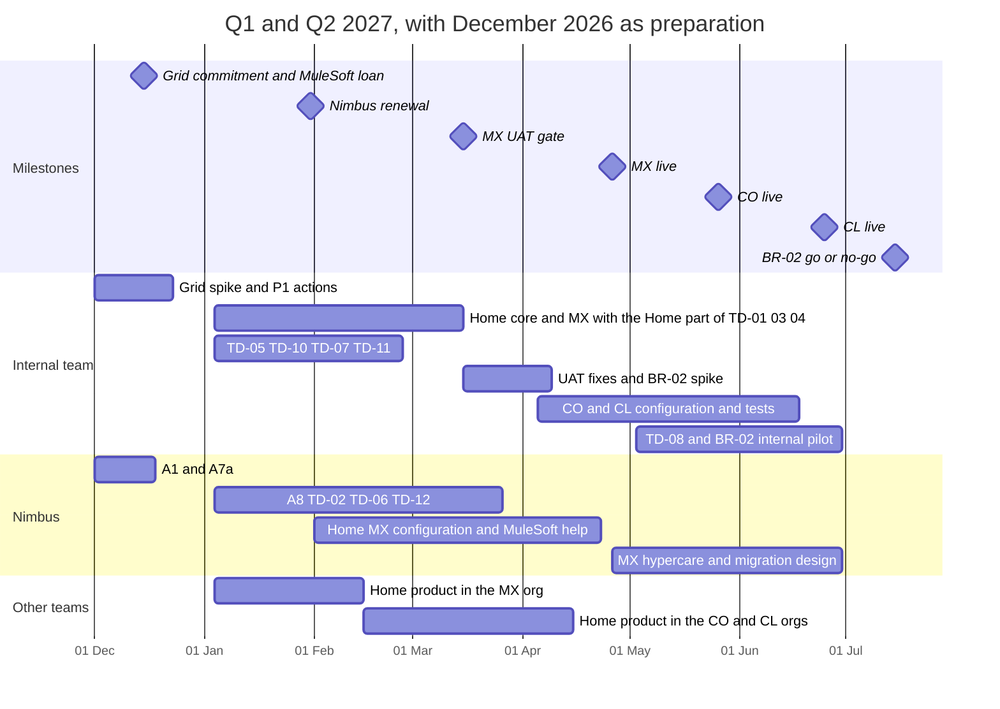

# Roadmap Q1–Q2 2027: Direct Digital Channel

Scope: Home Essentials (BR-01), the [technical debt inventory](../../context/TECH_DEBT_INVENTORY.md) (TD-01 to TD-12), the [INC-0907 actions](../operations/INC-0907-POSTMORTEM.md#5-action-items) (A1 to A11) and BR-02. December 2026 is preparation, because two requests are due by 15 Dec (`TEAM.md:19`, [ADR-0002](../adr/ADR-0002-channel-to-core-integration.md)).

## 1. Prioritization method

**Score = (Value + Urgency + Risk reduction) ÷ Effort**, each from 1 to 5. It is a simplified WSJF: the score says what goes first; capacity says what enters the plan (§3).

| Scale | 1 | 3 | 5 |
|---|---|---|---|
| Value | Internal only | Improves several journeys | Launches BR-01 or unblocks it |
| Urgency | No date | Needed this year | Date in H1, overdue, or P1 action |
| Risk reduction | None | Delivery risk | Prevents a repeat of INC-0907, or closes a security or legal finding |
| Effort (team estimate) | ≤ 1 pw | 3–6 pw (2 = 1–3 pw) | > 12 pw (4 = 6–12 pw) |

Rules: an item that blocks another one takes its urgency; large items are split (TD-01, TD-03 and TD-04 have a "Home part" and a "rest"); the score orders the work inside each capacity pool (internal, MuleSoft, Nimbus, other teams).

## 2. Scores

| Item | V | U | R | E | Score | When · who |
|---|---|---|---|---|---|---|
| A1 rating-table cache in `quote-papi-mx` | 3 | 5 | 5 | 1 | 13.0 | Dec · Nimbus |
| A2 retry standard | 2 | 5 | 5 | 1 | 12.0 | Dec · internal |
| A4 Salesforce consumption alerts | 2 | 5 | 5 | 1 | 12.0 | Dec · Salesforce platform team |
| A10 protocol with Payments | 2 | 4 | 5 | 1 | 11.0 | Q1 · Technical Lead |
| A11 "fresh prices" vs the 24-hour rule | 2 | 5 | 4 | 1 | 11.0 | Dec – 15 Jan · Product Owner |
| A6 month-end change freeze | 1 | 5 | 4 | 1 | 10.0 | Dec · internal |
| A7a interim approval of Nimbus releases | 1 | 5 | 4 | 1 | 10.0 | Dec · Technical Lead |
| A9 incident playbook | 2 | 3 | 4 | 1 | 9.0 | Q1 · Director, Technical Lead |
| TD-11 CL secrets in Key Vault | 1 | 3 | 4 | 1 | 8.0 | Q1 · internal |
| A3 bulkheads in `quote-xapi` | 3 | 5 | 5 | 2 | 6.5 | Dec–Jan · MuleSoft |
| TD-07 / A5 SLOs and alerts | 3 | 4 | 5 | 2 | 6.0 | Q1 · internal |
| TD-10 feature flags per country | 4 | 4 | 4 | 2 | 6.0 | Q1 · internal |
| TD-03 Home part: MX in `channel-bff` | 5 | 5 | 2 | 2 | 6.0 | Q1 · internal |
| TD-04 Home part: MX in `web-quote-ui` | 5 | 5 | 2 | 2 | 6.0 | Q1 · internal |
| Latent risks of the postmortem | 1 | 2 | 3 | 1 | 6.0 | Q1 · Data & Analytics, Identity |
| A8 `quote-papi-mx` through the System API | 2 | 4 | 5 | 2 | 5.5 | Q1 · Nimbus |
| TD-01 Home part: consolidated Process API | 5 | 5 | 2 | 3 | 4.0 | Q1 · MuleSoft |
| TD-02 MX issuance through the System API | 2 | 5 | 5 | 3 | 4.0 | Q1 · Nimbus |
| TD-08 retention of quote drafts | 1 | 3 | 4 | 2 | 4.0 | Q2 · internal |
| TD-05 contract tests | 3 | 4 | 4 | 3 | 3.7 | Q1 · internal |
| TD-06 / A7b Nimbus on Meridian pipelines | 2 | 4 | 5 | 3 | 3.7 | Q1 · Nimbus |
| BR-02 spike and internal pilot | 3 | 3 | 3 | 3 | 3.0 | Mar, Q2 · internal |
| TD-12 Spring Boot 2.7 upgrade | 1 | 3 | 4 | 3 | 2.7 | Q1 · Nimbus |
| **BR-01 Home Essentials** | 5 | 5 | 2 | 5 | 2.4 | Q1–Q2 · internal, Nimbus |
| TD-04 rest: MX journeys to `web-quote-ui` | 3 | 2 | 4 | 4 | 2.3 | H2 |
| TD-01 rest, TD-03 rest | 3 | 1 | 2 | 3 | 2.0 | H2 |
| TD-04 Angular 15 upgrade | 1 | 3 | 4 | 4 | 2.0 | Not done (§5) |
| TD-09 unit test coverage | 2 | 1 | 3 | 3 | 2.0 | Coverage gate on new code |
| BR-02 for customers now | 3 | 2 | 1 | 5 | 1.2 | Not in H1 ([`FEASIBILITY_GENAI.md`](FEASIBILITY_GENAI.md)) |

A3 and A5 come after the December month-end: A3 needs the only MuleSoft developer, and December has ≈ 5 pw (AS-11). Until they land, A1, A2, the A4 alerts and the A6 freeze cover the month-ends.

BR-01 scores 2.4 because it is large, not because it matters less. Everything above it adds up to ≈ 50 pw in all pools (≈ 30 internal), and §3 shows that the capacity covers that work and BR-01.

## 3. Capacity

[Assumptions AS-08 to AS-11](../../ASSUMPTIONS.md) split the estimates by phase and pool.

| | Q1 | Q2 |
|---|---|---|
| Internal capacity (`TEAM.md:17,19`) | 58 + 6 of the MuleSoft loan = 64 | 58 |
| Home Essentials: core and MX in Q1 (70%), CO and CL in Q2 (30%) of 45–55 pw (AS-09) | 31.5–38.5 | 13.5–16.5 |
| Home part of TD-01, TD-03 and TD-04 (AS-08) | 8–10 | — |
| TD-05, TD-10, TD-07, TD-11 | 7.5–10.5 | — |
| BR-02 spike, then pilot | 2–3 | 4–6 |
| TD-08 | — | 1–2 |
| **Internal demand** | **49–62 (77–97%)** | **18.5–24.5 (32–42%)** |
| Nimbus, after its run work (≈ 38, AS-10) | A8, TD-02, TD-06, TD-12 (12.5–17.5 pw); from February, Home MX configuration, tests and MuleSoft help (≈ 10 pw) | MX hypercare; design of the H2 migration |

**Q1 is the constraint.** Before the MX UAT gate on 15 Mar there are ≈ 54 pw (58 × 10/12 + 6) for 47–59 pw of work. For that reason Nimbus works on Home Essentials from February, as a term of the 31 Jan renewal (C8), in Meridian repositories and pipelines, with a Meridian code owner on each change ([ADR-0001](../adr/ADR-0001-regional-reuse-model.md)). **MuleSoft is the critical path:** Q1 needs 15.5–17.5 pw (30% of the MX share, the TD-01 Home part and A3) and has 15.6 with the loan, so there is no margin. Nimbus already maintains a MuleSoft application (`CURRENT_STATE.md:66`), so it pairs with our integration developer.

The free capacity of Q2 is reserve for work that slips from Q1, for launch defects and for the first month-ends with Home live; from June, the unused part prepares the H2 migration. Nimbus also has spare capacity in Q2: the renewal decides whether it starts the H2 migration earlier or Meridian contracts less (C9).

## 4. Plan and milestones

**Launch dates.** The three sponsor dates fall on the last day of the month, inside the change freeze of A6; the MX date also falls on its month-end peak (3×, C2). For that reason each country goes live before the freeze: advisors one week earlier, then a share of customers, and 100% by MX 26 Apr, CO 26 May and CL 25 Jun. The sponsor dates stay as "available at the latest".

**MX UAT gate (15 Mar):** load test at 3× the MX peak, fault injection ([ADR-0001](../adr/ADR-0001-regional-reuse-model.md)), penetration test, contract tests and SLO alerts live. If MX does not pass, we propose that MX launches with CO on 31 May, without going back to the Nimbus stack ([`ARCHITECTURE.md` §7](../architecture/ARCHITECTURE.md#7-transition-without-a-big-bang)).

| Dependency | From | Needed by |
|---|---|---|
| Grid commitment ([AS-02](../../ASSUMPTIONS.md)) and MuleSoft developer | Salesforce platform team | 15 Dec 2026 |
| Bands for the five answers ([AS-01](../../ASSUMPTIONS.md)); decision on A11 | Product Owner, pricing | 15 Jan 2027 |
| Documented basis for regional processing ([AS-06](../../ASSUMPTIONS.md)) | Legal | 31 Jan 2027 |
| Renewal terms: Meridian pipelines (A7b), work on Home Essentials | Vendor management, Nimbus | 31 Jan 2027 |
| Home Essentials configured in the MX org; in the CO and CL orgs | Salesforce platform team | 15 Feb; 15 Apr 2027 |
| Payment methods and policy document templates | Payments; Communications | MX 1 Mar; CO and CL 15 Apr 2027 |

A missed date goes to the architecture forum (`TEAM.md:24`) and then to the sponsor.

## 5. What we will not do in H1, and why

| Item | Why |
|---|---|
| BR-02 for customers | No approval for customer use, regulated-advice risk and no data on call deflection ([`FEASIBILITY_GENAI.md`](FEASIBILITY_GENAI.md)) |
| The rest of TD-01, TD-03 and TD-04 | Home Essentials needs only its part; the current journeys move one at a time in H2 ([`ARCHITECTURE.md` §7](../architecture/ARCHITECTURE.md#7-transition-without-a-big-bang)) |
| Angular 15 upgrade of `web-quote-ui-mx` | 5–7 pw for a frontend we retire; its journeys move first in H2. Until 30 Sep 2027: compensating controls (CSP, WAF, dependency scanning) and a Security exception. If Security rejects it, Nimbus upgrades in Q2 |
| TD-09 as a project | The coverage gate applies to new and changed code ([`ENGINEERING_STANDARDS.md` §2](../engineering/ENGINEERING_STANDARDS.md#2-delivery-flow-and-quality-gates)) |
| Price grid for the current products | The Salesforce platform team is busy with Home Essentials; we review it after 30 days of Home data ([ADR-0002](../adr/ADR-0002-channel-to-core-integration.md)) |

## 6. Delivery risks

| Risk | Early signal | Response |
|---|---|---|
| One MuleSoft developer on the critical path | MuleSoft backlog more than one sprint late | Loan requested before 15 Dec; Nimbus pairing; MuleSoft work first in each sprint |
| No grid commitment from the Salesforce platform team | No answer by 15 Dec | Plan B of AS-02; if the answer space is too large, live rating and the C1 gap declared ([ADR-0002](../adr/ADR-0002-channel-to-core-integration.md)) |
| The Nimbus renewal is late or rejects the terms | Not signed by 31 Jan | Nimbus stays on MX legacy work; the BR-02 spike moves to Q2; MX launches with CO |
| Rough estimates from September 2026 | Real velocity in sprint 2 | Re-estimate after the December spike; Q2 reserve |
| One QA engineer for three launches | UAT defects queue up | Developers own automated tests; QA focuses on UAT and exploratory tests ([`ENGINEERING_STANDARDS.md` §1](../engineering/ENGINEERING_STANDARDS.md#1-test-strategy)) |
